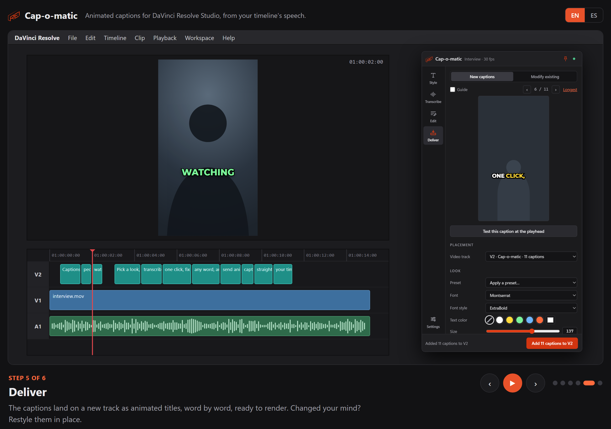

<picture>
  <source media="(prefers-color-scheme: dark)" srcset="images/cap-o-matic-logo-light.svg">
  
</picture>

# Cap-o-matic releases

Animated captions for DaVinci Resolve Studio, by ENNEA.

Download the latest version from **[Releases](https://github.com/maxpiens82/cap-o-matic-releases/releases/latest)**.

## See how it works

A one-minute walkthrough, in English or Spanish: **[maxpiens82.github.io/cap-o-matic-releases](https://maxpiens82.github.io/cap-o-matic-releases/)**

Recorrido de un minuto, en inglés o español: **[maxpiens82.github.io/cap-o-matic-releases](https://maxpiens82.github.io/cap-o-matic-releases/tour/?lang=es)**

## Install

1. Download `Cap-o-matic-<version>.lua` from the latest release.
2. Open DaVinci Resolve Studio, then **Workspace → Console**.
3. Drag the `.lua` file onto the Console. It installs Cap-o-matic and the fonts its presets use.
4. Restart Resolve, then open **Workspace → Workflow Integrations → Cap-o-matic**.

Updates install from the panel itself: **Settings → Check for updates**.

## Instalación

1. Descargá `Cap-o-matic-<versión>.lua` de la última versión.
2. Abrí DaVinci Resolve Studio y andá a **Workspace → Console**.
3. Arrastrá el archivo `.lua` a la consola. Instala Cap-o-matic y las fuentes que usan sus presets.
4. Reiniciá Resolve y abrí **Workspace → Workflow Integrations → Cap-o-matic**.

Las actualizaciones se instalan desde el propio panel: **Ajustes → Buscar actualizaciones**.

---

This repository holds releases only. The fonts included are under the SIL Open Font License; their licenses ship with the plugin.
